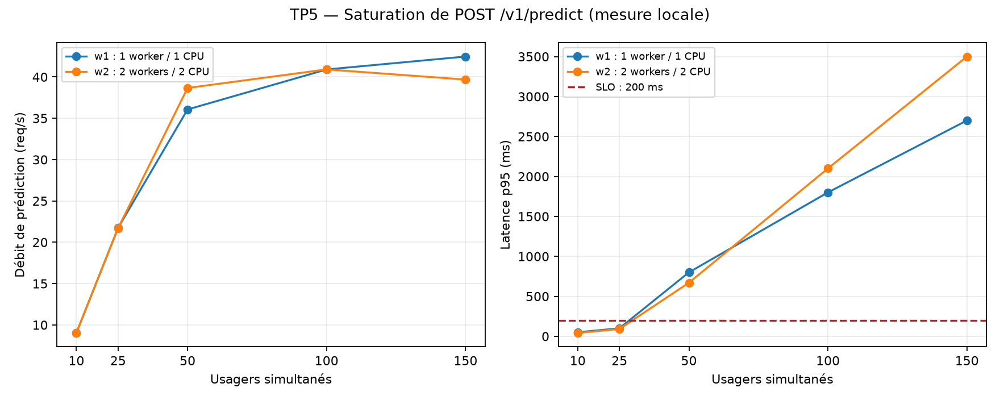

# velov-mlops

Projet fil rouge du cours **Industrialisation de l'IA dans le Cloud** (M2 Data Engineering / IA).

Objectif métier : prédire, pour chaque station Vélo'v, le nombre de vélos disponibles **dans une heure**,
et servir cette prédiction via une API fiable, conteneurisée, puis déployée (on-premise et cloud).

## Progression par session

Chaque étape du cours correspond à un tag git. Absent ou bloqué : repartez du tag de fin de la session précédente.

| Tag | Contenu |
|---|---|
| `s1-start` | Données simulées, features, entraînement. API à compléter (TP1) |
| `s1-end` | Modèle v0 servi par FastAPI, tests pytest |
| `s2-end` | Image Docker multi-stage, compose API + PostgreSQL, journalisation des prédictions |
| `s3-end` | Pipeline : collecte bronze, dbt silver et gold sur DuckDB, contrat Pandera, flow Prefect |
| `s4-end` | Suivi MLflow, registre (alias champion / challenger), promotion, export, CI GitHub Actions |

```bash
git checkout s1-end          # récupérer l'état de fin de S1
git checkout -b mon-binome   # travailler sur sa propre branche
```

## Démarrage rapide

Prérequis : Python 3.11+ (3.12 recommandé), git, Docker Desktop ou Docker Engine.

```bash
python -m venv .venv
source .venv/bin/activate            # Windows : .venv\Scripts\activate
pip install -r requirements-dev.txt
pip install -e .                     # rend le package velov importable

python -m velov.data                 # génère data/velov_history.csv (simulateur, seed fixe)
python -m velov.train                # entraîne et écrit models/model.joblib + models/metadata.json
python -m velov.train --mlflow       # idem + run tracé dans MLflow (voir « MLflow (S4) »)
pytest                               # tests
uvicorn velov.api.main:app --reload  # API sur http://127.0.0.1:8000/docs (--reload : en dev uniquement)
```

Exemple d'appel :

```bash
curl -X POST http://127.0.0.1:8000/v1/predict \
  -H "Content-Type: application/json" \
  -d '{"station_id": 3, "timestamp": "2026-10-06T08:00:00+02:00", "capacity": 20,
       "bikes_available": 12, "temperature": 14.5, "is_raining": false}'
```

Le `timestamp` doit porter un fuseau (`+02:00`, `Z`...) : sans fuseau, l'API répond 422.
Les instants sont renvoyés et journalisés en UTC (`"target_timestamp": "2026-10-06T07:00:00Z"`).

## Exigences du projet

Le service doit respecter les exigences de [docs/exigences.md](docs/exigences.md), de S1 à S9.
Chaque rendu indique celles qu'il couvre et comment le vérifier.

## Docker (S2)

```bash
python -m velov.data && python -m velov.train   # l'image embarque models/ : il doit exister
docker build -t velov-api:0.1.0 .
docker run --rm -p 8000:8000 velov-api:0.1.0

cp .env.example .env                            # puis changer POSTGRES_PASSWORD
docker compose up --build -d
docker compose logs -f api
docker compose down                             # -v pour supprimer aussi le volume Postgres
```

## Pipeline de données (S3)

```bash
python -m velov.ingest --replay data/fixtures     # bronze de démonstration (48 h, 20 stations)
python -m velov.ingest                            # ou un instantané du vrai flux de la Métropole
cd velov_dbt && dbt build --profiles-dir . && cd ..   # silver et gold, tests et contrat
python -m velov.contract                          # contrat Pandera sur la table gold
python -m velov.train --data data/velov.duckdb --test-days 1
python -m velov.flow                              # les trois étapes orchestrées par Prefect
```

dbt est le seul écrivain de `data/velov.duckdb` : le reste ouvre la base en lecture seule.
Collecte continue sur la VM : voir l'en-tête de `src/velov/ingest.py` (crontab, toutes les 5 minutes).

## MLflow (S4)

```bash
# même PostgreSQL que l'API (service db), base dédiée "mlflow" ; aucun nouveau secret
docker compose -f compose.yaml -f compose.mlflow.yaml up -d --build  # http://<ip-vm>:5000
export MLFLOW_TRACKING_URI=http://127.0.0.1:5000    # sans serveur : sqlite:///mlflow.db

python -m velov.train --version 0.1.0 --register    # run tracé + version "challenger"
python -m velov.promote                             # décision, sans rien changer
python -m velov.promote --apply                     # déplace l'alias "champion" si la règle est remplie
python -m velov.export --alias champion --out models/
./scripts/release.sh                                # sur la VM : export, build, redémarrage de l'API
```

La règle de promotion et la livraison du modèle sont justifiées dans `src/velov/promote.py`
et `docs/adr/0002-livraison-du-modele.md`. La CI est dans `.github/workflows/ci.yml`.

## Performance (TP5)

Le [runbook TP5](docs/runbook.md) précise le SLO, la capacité mesurée, les seuils
de préalerte proposés et les commandes de retour à la configuration w1 (EX-16).

### Protocole de mesure locale

Le TP5 part du tag `s4-end`, sur la branche `tp5`. La VM étant indisponible,
les mesures sont réalisées sur un poste Windows avec Ubuntu sous WSL et Docker Desktop.
L'API et Locust fonctionnent sur le même poste. Locust est installé dans l'environnement
Python du poste, hors de l'image de serving.

La configuration de référence à vérifier avant les paliers est : **1 worker Uvicorn,
quota CPU de l'API limité à 1 cœur**, API accessible sur `http://localhost:8000`.
La journalisation PostgreSQL reste activée. MLflow et les services inutiles doivent être
arrêtés pendant les mesures. Le poste reste sur secteur et les applications lourdes sont fermées.
Le quota CPU limite le temps processeur disponible ; il ne réserve pas un cœur exclusif.

| Élément du protocole | Valeur relevée |
|---|---|
| Processeur physique / RAM du poste | Non relevés ; les ressources WSL/Docker sont détaillées ci-dessous |
| CPU visibles depuis WSL (`os.cpu_count()`) | 8 processeurs logiques |
| Ressources CPU / RAM disponibles pour Docker Desktop | 8 CPU ; 8 165 916 672 octets de RAM (environ 7,61 Gio) |
| Version de Python du poste | 3.14.4 |
| Versions Docker client / serveur et Compose | Client et Engine 29.7.2 ; Docker Desktop 4.87.0 ; Compose v5.4.0 ; linux/amd64 ; contexte `default` |
| Version de Locust | 2.47.0, dans le venv WSL (Python 3.14.4) |
| Commit de base et état du dépôt lors du relevé | `84fcfa6b735ebe32206073ec92efa0e0c517869a` (`s4-end`) ; modifications locales non commitées, détaillées ci-dessous |
| Date et heure UTC | Relevé initial : 2026-11-17 à 11:06:29 UTC ; début w1-sans-mlflow : 11:36:08 UTC ; début w2 : 13:06:09 UTC le même jour (fichiers `protocole.txt`) |
| Version Python de l'image API | 3.14.10 ; modèle entraîné avec Python 3.14.4 |
| Version du modèle / SHA-256 de l'artefact | `0.1.0` ; `2efec564ec67fd4473e5794a0ef3ffecc94877ab650cf9911a0c8f45effa488c` |
| Source des données du modèle | CSV `data/velov_history.csv` du simulateur ; période des exemples : du 2026-05-31 22:00 UTC au 2026-08-29 20:00 UTC ; 36 460 exemples train et 6 720 test |

Au relevé initial, les fichiers modifiés étaient `README.md`, `docs/exigences.md` et
`pyproject.toml`. Les fichiers S5 ajoutés à l'index étaient `loadtest/locustfile.py`,
`loadtest/paliers.sh`, `loadtest/summary.py`, `exercices/s5_audit/locustfile_ia.py`,
`requirements-loadtest.txt` et `requirements-quantization.txt`. Les éléments non suivis
étaient `enonces/`, `payload.json` et `velov_dbt/.user.yml`. Le SHA seul ne représente
donc pas l'ensemble de cet état de travail ; le commit final des mesures sera à indiquer.

Le modèle a été entraîné le 2026-11-17 à 10:50:28 UTC avec scikit-learn 1.9.1,
pandas 3.0.2 et NumPy 2.4.6 (versions enregistrées dans ses métadonnées).
Sa MAE test est de 1,339 vélo, contre 1,879 pour la persistance.

Commandes de relevé, depuis la racine et avec l'environnement Python activé :

```bash
python -c "import os; print('CPU visibles:', os.cpu_count())"
python --version
docker version
docker compose version
locust --version
git rev-parse HEAD
git status --short
date -u
docker info --format 'CPU Docker={{.NCPU}} RAM Docker={{.MemTotal}} octets'
docker compose exec -T api python --version
docker inspect --format '{{.HostConfig.NanoCpus}}' "$(docker compose ps -q api)"
curl -i http://localhost:8000/ready
curl -s http://localhost:8000/v1/model
```

Pour la configuration de référence, `NanoCpus` doit valoir `1000000000`.
Le nombre de CPU visibles dans WSL ne remplace pas le relevé des ressources Docker.

### Vérification initiale

Avant la courbe de saturation, vérifier `/ready` et `/v1/predict` (HTTP 200),
puis exécuter un essai de 10 usagers pendant une minute :

```bash
locust -f loadtest/locustfile.py --host http://localhost:8000 \
  --headless -u 10 -r 10 -t 1m --only-summary
```

Résultats à reporter depuis les sorties réelles :

| Vérification | Résultat observé |
|---|---|
| `/ready` : HTTP 200 et en-tête `X-Process-Time-Ms` | HTTP 200 ; version `0.1.0` ; 0,77 ms sur un appel isolé (ne constitue pas une mesure du p95) |
| `/v1/predict` : HTTP 200 et réponse valide | Le 2026-11-17 à 11:13:44 UTC : HTTP 200 ; station 3 ; prédiction 11,33 vélos ; cible `2026-10-06T07:00:00Z` ; modèle `0.1.0` ; `X-Process-Time-Ms: 24.70` sur un appel isolé |
| API : 1 worker et quota CPU de 1 cœur | `NanoCpus=1000000000` ; commande inspectée : `uvicorn velov.api.main:app --host 0.0.0.0 --port 8000` (1 worker par défaut, sans option `--workers`) |
| Essai Locust : requêtes, débit et taux d'erreurs | 10 usagers, durée configurée 60 s ; 597 requêtes au total, aucune erreur ; `/v1/predict` : 547 requêtes, 9,21 req/s, 0 % d'erreurs ; code de sortie 0 |

Essai initial du 2026-11-17, de 12:19:06 à 12:20:06 (horodatage des logs Locust,
sans indication explicite du fuseau). Les percentiles ci-dessous sont les approximations
fournies par Locust ; les latences sont exprimées en millisecondes.

| Route | Requêtes | Erreurs | Débit (req/s) | Moyenne (ms) | p50 (ms) | p95 (ms) | p99 (ms) |
|---|---:|---:|---:|---:|---:|---:|---:|
| `POST /v1/predict` | 547 | 0 % | 9,21 | 20 | 14 | 37 | 210 |
| `GET /health` | 50 | 0 % | 0,84 | 3 | 3 | 7 | 17 |

L'essai initial satisfait le critère de 0 % d'erreurs. Le p95 de `/v1/predict`
est de 37 ms, inférieur au SLO visé de 200 ms pour cette charge de 10 usagers.
Ce premier essai ne détermine pas la capacité maximale : celle-ci sera estimée avec
les cinq paliers après un échauffement séparé. Les statistiques agrégées (10,05 req/s)
mélangent santé et prédiction ; elles ne sont pas utilisées comme débit de prédiction.
Le p99 reste indicatif sur cet échantillon de 547 prédictions.

L'appel unitaire de prédiction utilise le payload d'exemple (station 3, instant
`2026-10-06T08:00:00+02:00`, capacité 20, 12 vélos disponibles, température 14,5 °C,
sans pluie). La cible renvoyée correspond bien à H+1, en UTC. Les 24,70 ms relevées
sur cet appel ne constituent ni un percentile ni une validation du SLO sous charge.

### Courbe de saturation : configuration w1

La campagne retenue est `results/w1-sans-mlflow/`, relancée après l'arrêt de MLflow.
La première campagne `results/w1/`, avec MLflow actif, reste exploratoire.
Le protocole utilise un échauffement séparé de 1 minute, puis cinq paliers de
2 minutes : 10, 25, 50, 100 et 150 usagers. Configuration : 1 worker, quota de 1 CPU.
Le SLO visé est un p95 inférieur ou égal à **200 ms** sur `/v1/predict`.

Résultats de `python loadtest/summary.py results/w1-sans-mlflow --markdown`,
pour la route `/v1/predict` uniquement :

| Usagers | Requêtes | Erreurs | Débit (req/s) | p50 (ms) | p95 (ms) | p99 (ms) | SLO p95 |
|---|---:|---:|---:|---:|---:|---:|---|
| 10 | 1 074 | 0 % | 9,0 | 16 | 50 | 130 | Respecté |
| 25 | 2 589 | 0 % | 21,7 | 19 | 100 | 240 | Respecté |
| 50 | 4 299 | 0 % | 36,1 | 170 | 800 | 1 200 | Dépassé |
| 100 | 4 870 | 0 % | 40,9 | 1 300 | 1 800 | 2 100 | Dépassé |
| 150 | 5 058 | 0 % | 42,5 | 2 200 | 2 700 | 3 100 | Dépassé |

Le meilleur débit observé sous le SLO est **21,7 req/s à 25 usagers**.
Le premier palier hors SLO est celui de **50 usagers** : le p95 passe de 100 à
800 ms. Le seuil de franchissement se situe donc entre ces deux niveaux de charge,
sans mesure intermédiaire pour le préciser. À 150 usagers, le débit atteint
42,5 req/s, mais avec un p95 de 2 700 ms : ce débit ne constitue pas une capacité
respectant le SLO. Aucune erreur HTTP n'est relevée, malgré la dégradation de latence.
Les p99 sont indicatifs : chaque palier compte moins de 10 000 prédictions.

### Comparaison w1 / w2

La campagne `results/w2/` utilise les mêmes cinq paliers, durées et échauffement,
avec 2 workers et un quota de 2 CPU. La commande de lancement est :

```bash
docker compose -f compose.yaml -f compose.workers.yaml up -d api
docker update --cpus 2 "$(docker compose ps -q api)"
bash loadtest/paliers.sh http://localhost:8000 w2
python loadtest/summary.py results/w2 --markdown
```

Résultats w2 pour `/v1/predict` :

| Usagers | Requêtes | Erreurs | Débit (req/s) | p50 (ms) | p95 (ms) | p99 (ms) | SLO p95 |
|---|---:|---:|---:|---:|---:|---:|---|
| 10 | 1 078 | 0 % | 9,1 | 16 | 41 | 93 | Respecté |
| 25 | 2 585 | 0 % | 21,7 | 17 | 91 | 200 | Respecté |
| 50 | 4 606 | 0 % | 38,7 | 66 | 670 | 1 200 | Dépassé |
| 100 | 4 873 | 0 % | 40,9 | 1 400 | 2 100 | 2 800 | Dépassé |
| 150 | 4 726 | 0 % | 39,7 | 2 500 | 3 500 | 3 900 | Dépassé |

Comparaison à charge identique (débits arrondis à une décimale) :

| Usagers | w1 req/s | w2 req/s | w1 p95 (ms) | w2 p95 (ms) |
|---|---:|---:|---:|---:|
| 10 | 9,0 | 9,1 | 50 | 41 |
| 25 | 21,7 | 21,7 | 100 | 91 |
| 50 | 36,1 | 38,7 | 800 | 670 |
| 100 | 40,9 | 40,9 | 1 800 | 2 100 |
| 150 | 42,5 | 39,7 | 2 700 | 3 500 |



**Le débit ne double pas avec deux workers et deux CPU sur ce poste.** Le meilleur
débit observé sous le SLO reste voisin de 21,7 req/s à 25 usagers dans les deux
configurations. À 50 usagers, w2 améliore le débit d'environ 7,2 %, mais dépasse
toujours le SLO. À 150 usagers, le débit diminue d'environ 6,6 % et le p95 augmente
de 2 700 à 3 500 ms. Le pic de débit observé sur l'ensemble des paliers est de
42,5 req/s en w1 contre 40,9 req/s en w2 ; ces pics ne respectent pas le SLO.
Il s'agit d'une campagne par configuration, sans estimation de variabilité : ces
résultats ne suffisent pas à attribuer une cause interne à l'absence de gain.

### Diagnostic du goulot (étape 3)

Le script [scripts/bench_predict.py](scripts/bench_predict.py) reproduit les quatre
étapes de `_predict()` : DataFrame, features, prédiction avec clipping, construction
des réponses. Il vérifie l'égalité des réponses avec `_predict()`, charge le modèle
une seule fois et exclut 20 itérations d'échauffement par taille de lot. Les mesures
utilisent `perf_counter`, avec 500 répétitions et un thread de calcul natif.
`model.predict` est également chronométré séparément, features déjà préparées.
Le payload est répété à l'identique : ce microbenchmark contrôlé ne remplace pas
le trafic varié de Locust. Les percentiles du total sont calculés sur les durées
totales observées, sans additionner les percentiles des étapes.

À exécuter sur le poste des mesures, sans test de charge simultané :

```bash
python scripts/bench_predict.py --n 500 --out results/bench-predict-unit.json
python scripts/bench_predict.py --n 500 --batch 1 100 1000 \
  --out results/bench-predict-batches.json
curl -s -o /dev/null -D - -X POST http://localhost:8000/v1/predict \
  -H 'Content-Type: application/json' -d @payload.json
```

Résultats enregistrés sur `DESKTOP-9U0UV4H`, WSL2, Python 3.14.4, avec un thread
natif, 500 répétitions mesurées et 20 itérations d'échauffement exclues. Le SHA-256
du modèle correspond à celui de la section protocole. Ces microbenchmarks sont
exécutés dans le venv WSL, hors conteneur : la limite CPU Docker ne s'y applique pas.

Mesure unitaire commencée le 2026-11-17 à 13:39:36 UTC
(`results/bench-predict-unit.json`) :

| Étape, 1 ligne | p50 (ms) | p95 (ms) |
|---|---:|---:|
| Construction du DataFrame | 0,531 | 0,753 |
| Calcul et sélection des features | 2,869 | 3,752 |
| Pipeline predict + clipping | 4,373 | 5,635 |
| Construction des réponses | 0,041 | 0,063 |
| Total des quatre étapes | 7,865 | 10,151 |
| `model.predict` seul, mesure séparée | 4,213 | 6,281 |

**Le principal poste de coût parmi les quatre étapes est le pipeline de prédiction** :
son p50 est de 4,373 ms, devant le calcul des features (2,869 ms).
Le pipeline inclut le prétraitement scikit-learn, pas uniquement le régresseur.
Cette observation précise le coût de `_predict()` ; elle n'explique pas à elle seule
toute la saturation HTTP, qui inclut aussi la journalisation PostgreSQL.

Mesure des lots commencée à 13:39:44 UTC (`results/bench-predict-batches.json`),
avec features préparées hors chronométrage pour `model.predict` seul :

| Lignes | Predict seul p50 (ms/lot) | Predict seul p95 (ms/lot) | Total quatre étapes p50 (ms/lot) | Total p95 (ms/lot) |
|---|---:|---:|---:|---:|
| 1 | 5,709 | 11,120 | 9,182 | 37,337 |
| 100 | 5,423 | 9,453 | 10,431 | 17,489 |
| 1 000 | 12,500 | 26,954 | 22,084 | 46,038 |

Le temps par lot augmente bien moins que le nombre de lignes : le coût médian de
`model.predict` par ligne passe d'environ 5,709 ms à 0,054 ms (100 lignes) puis
0,013 ms (1 000 lignes). Cela montre un amortissement des coûts fixes sur cette
entrée répétée ; ce n'est pas une mesure du débit HTTP d'un service de batching.
Les deux mesures indépendantes à une ligne diffèrent (total p50 : 7,865 contre
9,182 ms), et le p95 varie davantage : les résultats dépendent aussi des conditions
d'exécution du poste. Le léger avantage médian du lot de 100 sur celui de 1 ne
suffit pas à conclure qu'un lot plus grand est intrinsèquement plus rapide.

Comparaison demandée avec le temps HTTP interne : le p50 Locust w1 à 10 usagers
est de **16 ms**, contre **24,70 ms** pour l'appel isolé `/v1/predict` relevé à
11:13:44 UTC en configuration initiale 1 worker / 1 CPU, soit un écart arithmétique
de **−8,70 ms** (Locust moins en-tête). Ce sont deux observations différentes,
pas des mesures appariées : cet écart négatif ne représente donc pas un coût réseau.
Le script exclut réseau, validation initiale, sérialisation JSON et journalisation
PostgreSQL ; l'en-tête HTTP couvre un autre périmètre. Les appels HTTP isolés ne
permettent pas de quantifier à eux seuls le coût réseau ou la latence sous saturation.

### Ressources observées : configuration w2

Configuration annoncée pour w2 : 2 workers sur un quota de 2 CPU. Les deux captures
de `docker stats --no-stream` ont été prises aux paliers de 100 puis 150 usagers.
Ce sont des relevés ponctuels, pas des moyennes sur les paliers.

| Usagers | CPU API | Mémoire API | CPU PostgreSQL | Mémoire PostgreSQL | CPU Locust |
|---|---:|---:|---:|---:|---|
| 100 | 197,90 % | 477,6 MiB | 2,61 % | 47,95 MiB | Non relevé |
| 150 | 199,13 % | 480,1 MiB | 3,05 % | 46,66 MiB | Non relevé |

L'API utilise presque l'équivalent de ses deux CPU disponibles lors de ces deux
observations. Cela indique une saturation de son quota CPU à forte charge, sans
identifier à lui seul l'étape interne responsable. La mémoire de l'API est proche
de 480 MiB. La limite mémoire affichée par Docker est de 7,605 GiB.

Le suivi `top` ayant été lancé trop tard pour la campagne w2 initiale, une campagne
complémentaire `w2-verification` a repris les paliers de 100 et 150 usagers avec
un échauffement séparé. Les captures montrent les processus Locust suivants :

| Usagers | PID Locust | CPU Locust observé | Comparaison au seuil de 90 % |
|---|---:|---:|---|
| 100 | 76815 | 9,0 % | Inférieur au seuil |
| 150 | 77984 | 10,0 % | Inférieur au seuil |

Ces deux relevés ponctuels ne montrent pas de saturation CPU du générateur de
charge aux instants observés. Ils ne constituent ni des moyennes ni des maxima
sur les paliers et ne décrivent pas rétroactivement la campagne w2 initiale.
Les relevés CPU/mémoire de w1 n'ont pas été conservés.

### Vérification avant rendu

Vérification locale du 17 novembre 2026 : Ruff lint et format réussis, ainsi que
les 41 tests de la suite. Commande de tests utilisée :

```bash
OMP_NUM_THREADS=1 OPENBLAS_NUM_THREADS=1 python -m pytest -p no:locust -q
```

Le plugin pytest fourni par Locust est désactivé pour cette suite applicative ;
les campagnes Locust sont exécutées séparément avec les commandes ci-dessus.
Le contrôle CI du commit final sur le fork reste à effectuer avant de publier le tag `tp5`.

## Structure

```
src/velov/
  data.py          simulateur de données (remplacé par l'open data en S3, même schéma)
  features.py      features partagées entraînement / API (anti training-serving skew)
  ingest.py        collecte du flux GBFS vers data/bronze, idempotente (S3)
  contract.py      contrat Pandera de la table d'entraînement (S3)
  flow.py          flow Prefect : ingestion, dbt, contrat (S3)
  train.py         entraînement, baseline, paquet model.joblib + metadata.json
  tracking.py      run MLflow, registre, alias (S4)
  promote.py       règle de promotion challenger / champion (S4)
  export.py        version du registre -> models/ avant le build (S4)
  retrain.py       réentraînement : entraîner, enregistrer, décider (S4)
  api/main.py      FastAPI : /health, /ready, /v1/model, /v1/predict, /v1/predict/batch
  api/schemas.py   contrat d'entrée / sortie (Pydantic)
  api/storage.py   journalisation des prédictions (S2)
tests/             pytest (features, API, ingestion, contrat, qualité du modèle, registre)
.github/workflows/ CI : lint, tests, scan de secrets, build et /ready de l'image (S4)
docs/              templates : model card, runbook, ADR
velov_dbt/         projet dbt : silver (stg_*), gold (station_hourly), tests, contrat (S3)
data/fixtures/     bronze de démonstration, régénérable avec scripts/make_fixtures.py (S3)
exercices/         démo pickle (S1), audit, debug et conformité Docker (S2), audit SQL (S3)
```

## Usage de l'IA générative

Chaque activité indique son mode : **sans IA**, **IA déclarée** ou **IA imposée**.
En mode IA déclarée, ajoutez dans la description de vos commits ou de votre rendu :
outil utilisé, ce que vous lui avez demandé, ce que vous avez vérifié ou corrigé.

Pour ce TP5, nous avons utilisé Codex pour comprendre les consignes, préparer les commandes Docker et Locust, structurer le README et le runbook en français, générer le script de benchmark et le graphique à partir des résultats CSV.

Nous avons exécuté les tests de charge et les benchmarks sur notre poste. Les tableaux utilisent les mesures réellement obtenues.

Nous avons corrigé le protocole en arrêtant MLflow avant la campagne retenue. Les relevés CPU de Locust effectués ultérieurement ont été distingués de la campagne initiale pour ne pas attribuer des observations à une autre mesure. Nous avons également distingué le temps d’un appel HTTP isolé des percentiles mesurés sous charge.

Le script de benchmark a été vérifié avec Ruff et par comparaison de ses réponses avec celles de _predict(). Les conclusions restent limitées à la configuration locale mesurée.
