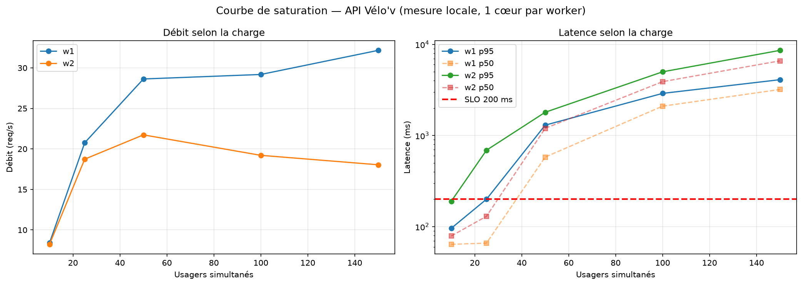

# velov-mlops

Projet fil rouge du cours **Industrialisation de l'IA dans le Cloud** (M2 Data Engineering / IA).

Objectif métier : prédire, pour chaque station Vélo'v, le nombre de vélos disponibles **dans une heure**,
et servir cette prédiction via une API fiable, conteneurisée, puis déployée (on-premise et cloud).

## Progression par session

Chaque étape du cours correspond à un tag git. Absent ou bloqué : repartez du tag de fin de la session précédente.

| Tag | Contenu |
|---|---|
| `s1-start` | Données simulées, features, entraînement. API à compléter (TP1) |
| `s1-end` | Modèle v0 servi par FastAPI, tests pytest |
| `s2-end` | Image Docker multi-stage, compose API + PostgreSQL, journalisation des prédictions |
| `s3-end` | Pipeline : collecte bronze, dbt silver et gold sur DuckDB, contrat Pandera, flow Prefect |
| `s4-end` | Suivi MLflow, registre (alias champion / challenger), promotion, export, CI GitHub Actions |

```bash
git checkout s1-end          # récupérer l'état de fin de S1
git checkout -b mon-binome   # travailler sur sa propre branche
```

## Démarrage rapide

Prérequis : Python 3.11+ (3.12 recommandé), git, Docker Desktop ou Docker Engine.

```bash
python -m venv .venv
source .venv/bin/activate            # Windows : .venv\Scripts\activate
pip install -r requirements-dev.txt
pip install -e .                     # rend le package velov importable

python -m velov.data                 # génère data/velov_history.csv (simulateur, seed fixe)
python -m velov.train                # entraîne et écrit models/model.joblib + models/metadata.json
python -m velov.train --mlflow       # idem + run tracé dans MLflow (voir « MLflow (S4) »)
pytest                               # tests
uvicorn velov.api.main:app --reload  # API sur http://127.0.0.1:8000/docs (--reload : en dev uniquement)
```

Exemple d'appel :

```bash
curl -X POST http://127.0.0.1:8000/v1/predict \
  -H "Content-Type: application/json" \
  -d '{"station_id": 3, "timestamp": "2026-10-06T08:00:00+02:00", "capacity": 20,
       "bikes_available": 12, "temperature": 14.5, "is_raining": false}'
```

Le `timestamp` doit porter un fuseau (`+02:00`, `Z`...) : sans fuseau, l'API répond 422.
Les instants sont renvoyés et journalisés en UTC (`"target_timestamp": "2026-10-06T07:00:00Z"`).

## Exigences du projet

Le service doit respecter les exigences de [docs/exigences.md](docs/exigences.md), de S1 à S9.
Chaque rendu indique celles qu'il couvre et comment le vérifier.

## Docker (S2)

```bash
python -m velov.data && python -m velov.train   # l'image embarque models/ : il doit exister
docker build -t velov-api:0.1.0 .
docker run --rm -p 8000:8000 velov-api:0.1.0

cp .env.example .env                            # puis changer POSTGRES_PASSWORD
docker compose up --build -d
docker compose logs -f api
docker compose down                             # -v pour supprimer aussi le volume Postgres
```

## Pipeline de données (S3)

```bash
python -m velov.ingest --replay data/fixtures     # bronze de démonstration (48 h, 20 stations)
python -m velov.ingest                            # ou un instantané du vrai flux de la Métropole
cd velov_dbt && dbt build --profiles-dir . && cd ..   # silver et gold, tests et contrat
python -m velov.contract                          # contrat Pandera sur la table gold
python -m velov.train --data data/velov.duckdb --test-days 1
python -m velov.flow                              # les trois étapes orchestrées par Prefect
```

dbt est le seul écrivain de `data/velov.duckdb` : le reste ouvre la base en lecture seule.
Collecte continue sur la VM : voir l'en-tête de `src/velov/ingest.py` (crontab, toutes les 5 minutes).

## MLflow (S4)

```bash
# même PostgreSQL que l'API (service db), base dédiée "mlflow" ; aucun nouveau secret
docker compose -f compose.yaml -f compose.mlflow.yaml up -d --build  # http://<ip-vm>:5000
export MLFLOW_TRACKING_URI=http://127.0.0.1:5000    # sans serveur : sqlite:///mlflow.db

python -m velov.train --version 0.1.0 --register    # run tracé + version "challenger"
python -m velov.promote                             # décision, sans rien changer
python -m velov.promote --apply                     # déplace l'alias "champion" si la règle est remplie
python -m velov.export --alias champion --out models/
./scripts/release.sh                                # sur la VM : export, build, redémarrage de l'API
```

La règle de promotion et la livraison du modèle sont justifiées dans `src/velov/promote.py`
et `docs/adr/0002-livraison-du-modele.md`. La CI est dans `.github/workflows/ci.yml`.

## Structure

```
src/velov/
  data.py          simulateur de données (remplacé par l'open data en S3, même schéma)
  features.py      features partagées entraînement / API (anti training-serving skew)
  ingest.py        collecte du flux GBFS vers data/bronze, idempotente (S3)
  contract.py      contrat Pandera de la table d'entraînement (S3)
  flow.py          flow Prefect : ingestion, dbt, contrat (S3)
  train.py         entraînement, baseline, paquet model.joblib + metadata.json
  tracking.py      run MLflow, registre, alias (S4)
  promote.py       règle de promotion challenger / champion (S4)
  export.py        version du registre -> models/ avant le build (S4)
  retrain.py       réentraînement : entraîner, enregistrer, décider (S4)
  api/main.py      FastAPI : /health, /ready, /v1/model, /v1/predict, /v1/predict/batch
  api/schemas.py   contrat d'entrée / sortie (Pydantic)
  api/storage.py   journalisation des prédictions (S2)
tests/             pytest (features, API, ingestion, contrat, qualité du modèle, registre)
.github/workflows/ CI : lint, tests, scan de secrets, build et /ready de l'image (S4)
docs/              templates : model card, runbook, ADR
velov_dbt/         projet dbt : silver (stg_*), gold (station_hourly), tests, contrat (S3)
data/fixtures/     bronze de démonstration, régénérable avec scripts/make_fixtures.py (S3)
exercices/         démo pickle (S1), audit, debug et conformité Docker (S2), audit SQL (S3)
```

## Performance (TP5, EX-16)

### Protocole

- **Mesure locale** : API et Locust sur le même poste (VM indisponible)
- **Poste** : Windows 11, 8 cœurs, Python 3.11.9
- **API** : conteneur Docker, limitée à 1 cœur (`docker update --cpus 1`)
- **Locust** : 2.47.0, sur les cœurs restants
- **Commit** : `84fcfa6` (s4-end), modèle v0.1.0
- **Paliers** : échauffement 1 min (non compté), puis 10 / 25 / 50 / 100 / 150 usagers, 2 min par palier
- **Date** : 2026-11-17

### Relancer la mesure (local ou VM)

Depuis le poste, dans Git Bash, avec l'environnement virtuel activé (Locust tourne toujours sur le poste) :

```bash
./loadtest/lancer.sh local w1                            # API Docker sur le poste, 1 cœur
API_WORKERS=2 API_CPUS=2 ./loadtest/lancer.sh local w2   # 2 workers, 2 cœurs
./loadtest/lancer.sh vm w1                               # API sur la VM -> results/vm-w1
python scripts/plot_saturation.py results/w1 results/w2  # courbe
```

La limite de cœurs est écrite dans `compose.loadtest.yaml` (`deploy.resources.limits.cpus`) au lieu du `docker update` manuel.
La cible `vm` envoie le commit courant sur la VM (remote `vm`, branche `loadtest`), y relance l'API, puis lance les mêmes paliers.
Si la VM est injoignable, le script s'arrête : pas de repli silencieux sur le local, chaque protocole indique `cible=local` ou `cible=vm`.

### Courbe de saturation — 1 worker, 1 cœur (w1)

| usagers | requêtes | erreurs % | débit req/s | p50 ms | p95 ms | p99 ms | SLO p95 |
|---|---|---|---|---|---|---|---|
| 10 | 998 | 0.0 | 8.4 | 64 | 96 | 220 | ok |
| 25 | 2463 | 0.0 | 20.8 | 66 | 200 | 560 | ok |
| 50 | 3399 | 0.0 | 28.6 | 580 | 1300 | 1600 | KO |
| 100 | 3422 | 0.0 | 29.2 | 2100 | 2900 | 4000 | KO |
| 150 | 3820 | 0.0 | 32.2 | 3200 | 4100 | 5400 | KO |

**Capacité sous le SLO** (p95 ≤ 200 ms) : environ **21 req/s** (25 usagers). Le débit plafonne à ~30 req/s au-delà.

### Courbe de saturation — 2 workers, 2 cœurs (w2)

| usagers | requêtes | erreurs % | débit req/s | p50 ms | p95 ms | p99 ms | SLO p95 |
|---|---|---|---|---|---|---|---|
| 10 | 980 | 0.0 | 8.2 | 79 | 190 | 550 | ok |
| 25 | 2211 | 0.0 | 18.7 | 130 | 690 | 1200 | KO |
| 50 | 2587 | 0.0 | 21.7 | 1200 | 1800 | 2100 | KO |
| 100 | 2289 | 0.0 | 19.2 | 3900 | 5000 | 5600 | KO |
| 150 | 1271 | 0.0 | 17.8 | 6600 | 8400 | 8900 | KO |

**Capacité sous le SLO** : environ **8 req/s** (10 usagers seulement).

### Courbe de saturation



### Comparaison et conclusion

Ajouter un 2e worker **dégrade** les performances au lieu de les doubler :
- Le débit maximal passe de 32 à 18 req/s (−44 %)
- La capacité sous le SLO passe de 21 à 8 req/s (−62 %)

**Cause probable** : chaque worker fork un process qui charge son propre modèle et ouvre sa propre connexion PostgreSQL. La journalisation synchrone en base (table `predictions`) crée une contention sur le verrou de la base, et l'overhead du multi-process (fork, GIL par process, mémoire doublée) l'emporte sur le gain de parallélisme pour ce niveau de charge.

### Goulot d'étranglement

Temps mesuré par étape dans `_predict()` (500 itérations, batch=1, échauffement exclu) :

| Étape | p50 (ms) | p95 (ms) |
|---|---|---|
| model_dump (Pydantic) | 0.9 | 1.3 |
| add_features (pandas) | 5.9 | 7.8 |
| predict (sklearn) | 9.7 | 13.1 |
| response (construction) | 0.1 | 0.1 |
| **TOTAL** | **16.6** | **22.3** |

Le **goulot** est `model.predict` (58 % du temps au p50), suivi de `add_features` (36 %).
`X-Process-Time-Ms` pour une requête isolée : ~14 ms. Le p50 Locust à 10 usagers (64 ms) inclut le serveur HTTP et la sérialisation JSON.

Prédire 1 ligne coûte presque autant que 100 (~17 ms vs ~18 ms) : le coût fixe du pipeline domine.

## Usage de l'IA générative

Chaque activité indique son mode : **sans IA**, **IA déclarée** ou **IA imposée**.
En mode IA déclarée, ajoutez dans la description de vos commits ou de votre rendu :
outil utilisé, ce que vous lui avez demandé, ce que vous avez vérifié ou corrigé.
